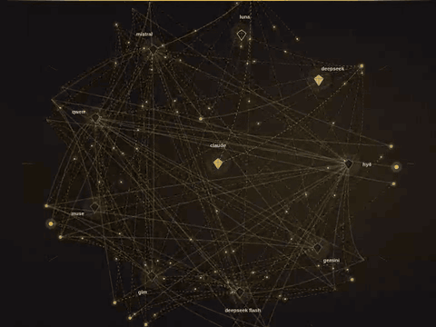

<div align="center">


# THE HIGH COUNCIL

"A beginning is the time for taking the most delicate care that the balances are correct"<br>
Frank Herbert, *Dune*

---

You bring an idea for a new project, a feature or any kind of update.<br>
THC debates your idea and the Software Engineering behind it.<br>
Through multiple debate rounds and 3 layers of judges, they catch a lot of things that even your strongest initial draft-writing LLM will not have thought about.<br>
The goal is to get everyone to work together, in harmony and with manners.

[](LICENSE)
[](https://www.npmjs.com/package/the-high-council)
[](https://registry.modelcontextprotocol.io/v0/servers?search=io.github.muad-yasin/the-high-council)

[Website](https://sower-industries.de/en/THC/) · [Pricing](#pricing) · [AI-Readme (the full text)](AI-README.md) · [Changelog](CHANGELOG.md) · [Known limits](#known-limits-stated-plainly)



</div>

## Try it in 30 seconds

    npx the-high-council council demo

No keys, no network, $0. Add it to Claude Code as an MCP server:

    claude mcp add council -- npx -y the-high-council council --mcp

Claude Desktop, the plugin and other clients: [Use it with your coding agent](#use-it-with-your-coding-agent).

## Contents

- **This page:** [What you get](#what-you-get) · [What's new](#whats-new-in-084) · [The chains](#the-chains-who-sits-where) · [Pricing](#pricing) · [Your first run](#your-first-run) · [Known limits](#known-limits-stated-plainly) · [Privacy](#privacy)
- **The manual:** [AI-Readme (the full text)](AI-README.md) · [Your first ten minutes](AI-README.md#your-first-ten-minutes) · [How it works](AI-README.md#how-it-works) · [Chains](AI-README.md#chains) · [The spend cap](AI-README.md#the-spend-cap) · [Accessibility](AI-README.md#accessibility)
- **More:** [Troubleshooting](TROUBLESHOOTING.md) · [Agent skills](skills/README.md) · [Personas](PERSONAS.md) · [Contributing](CONTRIBUTING.md) · [Changelog](CHANGELOG.md)

## What you get

1. **Criteria before planning.** Your request becomes a short list of yes/no checks the plan has to pass, written before anyone plans.
2. **Blind proposals and a recorded debate.** Each lab proposes without seeing the others, then reads the rest with the names hidden and posts support, an objection or a merge. Every author then keeps, amends or withdraws its own proposal, on the record.
3. **Review and revision.** A panel of judges checks the draft against the criteria, and a failed check sends it back for a revision. The planning chains judge in three layers. An objection that was never settled stays on the record; nothing is averaged away.
4. **A handoff for building.** `HANDOFF.md` is written for whoever builds the plan: the acceptance checks and the instructions a coding agent works from, and in the planning chains the milestones too.

Every run writes a folder, `runs/<id>/`:

| File | What it gives you |
|---|---|
| `deliverable.md` | The plan |
| `BOARD.md` | The whole debate: every post, every withdrawal |
| `HANDOFF.md` | The build instructions and the acceptance checks, for the coding agent |
| `report.json` | The same board, structured, with the token and cost accounting |

> **On what this does and doesn't claim.** This repo publishes the mechanism: the chains, the seat
> rosters, the stage order. Exact effectiveness numbers are not measured yet. We did have a selected
> Council debate measured by frontier AI on the run that planned
> update 0.8.3: the plan improved in every measured rubric but one, and that one was that it got
> longer and harder to read. What the repo does, concretely, is make disagreement between models
> *visible and recorded* instead of averaged away - you can read who objected to what, who withdrew
> a proposal under argument, and who held their position.

## What's new in 0.8.4

- **The ladder is the shape of every shipped planning chain.** Layer 1 revises in blocks, layer 2 is asked in visits, then layer 3 reads. There is no round limit, so a run ends on agreement, on a stall the top layer holds, or at the limit you type or when you stop it.
- **A plan the panel did not agree on can be accepted as it stands.** `council accept` records who accepted it, when and why, and which objections and late findings still stand. It agrees with no judge and marks nothing agreed.
- **You can give the judges a ruling in the middle of a run.** `council ruling-add` asks for a ruling; once you have approved it, the judges and the reviser read it from the next pass on.
- **Excerpts.** The session that handles the run can add text from your project during the run: files it read, or passages a judge or a proposer asked for. Every later seat is shown the text.
- **Seat personas.** A seat can carry a name as its title or, with an optional feature, debate in the voice of that persona ([PERSONAS.md](PERSONAS.md)).
- **Gone:** the experimental advice add-on. **Changed:** the default spending cap is $12 (it was $7), and Node.js 24 or newer is the supported version.

0.8.4 also changes things a script or a client may rely on. Read "Changes that can break a script or a client" in the [CHANGELOG](CHANGELOG.md) before you update.

## What's new in 0.8.3

- [Recursive Councils](#recursive-councils-plans-within-plans-within-plans) - "Plans within Plans within Plans"

## The chains: who sits where

Which model sits on each proposer and judge seat of every shipped chain, and under which title.

<!-- chains:start (generated by scripts/chain-overview.mjs from the chain files: edit the chains, then run it) -->

| Chain | Layer | Title | Model |
|---|---|---|---|
| `plan-mini-council` | Proposer | Noah | `deepseek/deepseek-v4.1-flash-1017` |
|  | Proposer | Husayn | `z-ai/glm-5.3-flash` |
|  | Proposer | Abraham | `mistralai/mistral-large-4-0` |
|  | 1 | Matthew | `claude-haiku-5-5` |
|  | 1 | Merkel | `openai/gpt-6-luna` |
|  | 1 | Van Gogh | `minimax/minimax-m3.1-flash` |
|  | 2 | Aristotle | `deepseek/deepseek-v4.1-flash-1017` |
|  | 2 | Archimedes | `z-ai/glm-5.3` |
|  | 2 | Plato | `qwen/qwen3.8-27b` |
|  | 3 | Melchizedek | `claude-sonnet-5-5` |
|  | 3 | Karpathy | `openai/gpt-6.1-terra` |
| `plan-medium-council` | Proposer | Noah | `claude-sonnet-5-5` |
|  | Proposer | Husayn | `deepseek/deepseek-v4.1-flash-1017` |
|  | Proposer | Abraham | `z-ai/glm-5.3` |
|  | 1 | Matthew | `claude-haiku-5-5` |
|  | 1 | Merkel | `openai/gpt-6-luna` |
|  | 1 | Van Gogh | `minimax/minimax-m3.1-flash` |
|  | 2 | Archimedes | `z-ai/glm-5.3` |
|  | 2 | da Vinci | `mistralai/mistral-large-4-0` |
|  | 2 | Aristotle | `deepseek/deepseek-v4.1-flash-1017` |
|  | 3 | Melchizedek | `claude-opus-5-5` |
|  | 3 | Karpathy | `openai/gpt-6.1-sol` |
| `plan-high-council` | Proposer | Noah | `claude-opus-5-5` |
|  | Proposer | Husayn | `deepseek/deepseek-v4.1-flash-1017` |
|  | Proposer | Abraham | `openai/gpt-6.1-sol` |
|  | 1 | Matthew | `claude-haiku-5-5` |
|  | 1 | Merkel | `openai/gpt-6-luna` |
|  | 1 | Herbert | `z-ai/glm-5.3-flash` |
|  | 1 | Van Gogh | `minimax/minimax-m3.1-flash` |
|  | 1 | Aristotle | `deepseek/deepseek-v4.1-flash-1017` |
|  | 2 | Moses | `claude-opus-5-5` |
|  | 2 | Einstein | `openai/gpt-6.1-sol` |
|  | 2 | da Vinci | `mistralai/mistral-large-4-0` |
|  | 2 | Archimedes | `moonshotai/kimi-k3.1-pro` |
|  | 2 | Plato | `qwen/qwen3.8-27b` |
|  | 3 | Melchizedek | `claude-fable-5-2` |
|  | 3 | Karpathy | `openai/gpt-6-astra` |
| `plan-claude-council` | Proposer | Noah | `claude-sonnet-5-5` |
|  | Proposer | Husayn | `claude-opus-5-5` |
|  | Proposer | Abraham | `claude-fable-5-2` |
|  | 1 | Matthew | `claude-haiku-5-5` |
|  | 1 | Van Gogh | `claude-haiku-5-5` |
|  | 1 | Herbert | `claude-sonnet-5-5` |
|  | 2 | Plato | `claude-sonnet-5-5` |
|  | 2 | da Vinci | `claude-sonnet-5-5` |
|  | 2 | Moses | `claude-opus-5-5` |
|  | 3 | Melchizedek | `claude-fable-5-2` |
|  | 3 | Karpathy | `claude-opus-5-5` |
| `plan-china-medium-council` | Proposer | Noah | `deepseek/deepseek-v4.1-flash-1017` |
|  | Proposer | Husayn | `z-ai/glm-5.3-flash` |
|  | Proposer | Abraham | `minimax/minimax-m3.1-flash` |
|  | 1 | Herbert | `z-ai/glm-5.3-flash` |
|  | 1 | Van Gogh | `minimax/minimax-m3.1-flash` |
|  | 1 | Einstein | `qwen/qwen3.8-flash` |
|  | 2 | Aristotle | `deepseek/deepseek-v4.1-flash-1017` |
|  | 2 | da Vinci | `xiaomi/mimo-v2.6-pro` |
|  | 2 | Plato | `qwen/qwen3.8-27b` |
|  | 3 | Melchizedek | `z-ai/glm-5.3` |
|  | 3 | Karpathy | `qwen/qwen3.8-max-0902` |
| `plan-china-high-council` | Proposer | Noah | `moonshotai/kimi-k3.1-pro` |
|  | Proposer | Husayn | `z-ai/glm-5.3` |
|  | Proposer | Abraham | `deepseek/deepseek-v4.1-flash-1017` |
|  | 1 | Herbert | `z-ai/glm-5.3-flash` |
|  | 1 | Van Gogh | `minimax/minimax-m3.1-flash` |
|  | 1 | Einstein | `qwen/qwen3.8-flash` |
|  | 2 | Aristotle | `deepseek/deepseek-v4.1-flash-1017` |
|  | 2 | Archimedes | `z-ai/glm-5.3` |
|  | 2 | Plato | `qwen/qwen3.8-27b` |
|  | 3 | Melchizedek | `moonshotai/kimi-k3.1-pro` |
|  | 3 | Karpathy | `qwen/qwen3.8-max-0902` |
| `local-ollama` | Judge | – | `qwen2.5` |
|  | Judge | – | `mistral` |
| `plan-the-high-council` | Proposer | Noah | `claude-opus-5-5` |
|  | Proposer | Husayn | `deepseek/deepseek-v4.1-flash-1017` |
|  | Proposer | Abraham | `openai/gpt-6.1-sol` |
|  | 1 | Matthew | `claude-haiku-5-5` |
|  | 1 | Merkel | `openai/gpt-6-luna` |
|  | 1 | Herbert | `z-ai/glm-5.3-flash` |
|  | 1 | Van Gogh | `minimax/minimax-m3.1-flash` |
|  | 1 | Aristotle | `deepseek/deepseek-v4.1-flash-1017` |
|  | 2 | Moses | `claude-opus-5-5` |
|  | 2 | Einstein | `openai/gpt-6.1-sol` |
|  | 2 | da Vinci | `mistralai/mistral-large-4-0` |
|  | 2 | Archimedes | `moonshotai/kimi-k3.1-pro` |
|  | 2 | Plato | `qwen/qwen3.8-27b` |
|  | 3 | Melchizedek | `claude-fable-5-2` |
|  | 3 | Karpathy | `openai/gpt-6-astra` |

<!-- chains:end -->

- The flagship, `plan-the-high-council`, sits at the bottom. In addition to the titles, its seats have personas with prompted voices ([PERSONAS.md](PERSONAS.md)).
- On every planning chain, an agent session of your own, such as Claude Code, answers the writer stages.

## Pricing

What each shipped chain costs per run, in US dollars. `council doctor` prints the same expected figures; `--dry-run` prices your own task, and a longer task costs more.

- **Expected** is worked out by the code before anything is sent, from the shipped price table and the chain's own size estimates.
- The shipped planning chains have no round limit: there **Expected** assumes three top-layer reads, an assumption that a lower number you type with `--rounds` replaces.
- A run can cost more than **Expected**. The limit you type is what stops it.
- **Tested** is what real runs cost; – means no run has been reported yet.
- Seats your Claude Code session answers cost $0 here, because they run on your own subscription.

<!-- pricing:start (generated by scripts/pricing-table.mjs: edit maintainers/run-costs.json or the chains, then run it) -->

| Chain | Expected | Tested (real runs) |
|---|---|---|
| **Planning chains** | | |
| `plan-mini-council` | $9.52 | – |
| `plan-medium-council` | $14.78 | $3.6 |
| `plan-high-council` | $31.56 | – |
| `plan-the-high-council` | $31.71 | – |
| **Variants** | | |
| `plan-claude-council` | $37.11 | – |
| **Chinese-lab alternatives** | | |
| `plan-china-medium-council` | $8.82 | – |
| `plan-china-high-council` | $14.88 | – |
| **Other** | | |
| `local-ollama` | $0.00 | – |

<!-- pricing:end -->

With recursive councils, a tree at the default limits runs up to 12 councils (the root and 11 sub-plans): the root on the chain you name with `--chain`, each sub-plan on the chain you name with `--child-chain`, or on the root chain when you name none. With one chain throughout, which is the default, you pay for up to 12 runs of that chain; `council tree start --dry-run` prints the projection for your own task and chains, and the limit you type stops the tree.

Ran one of these chains? [CONTRIBUTING.md](CONTRIBUTING.md#send-a-run-cost) says how to send us the figure.

<a id="setup"></a>
<a id="quick-start-cli"></a>

## Your first run

The quick-start chain, `plan-mini-council` (it is also the default chain), needs **an [OpenRouter](https://openrouter.ai) API key** (one account that reaches many labs' models) and an agent session of your own, such as Claude Code, that answers its writer stages. With **an [Anthropic](https://console.anthropic.com) API key** as well, its Claude seats are called at Anthropic directly; without one they go through OpenRouter.

1. **Keys.** Put the keys in a file called `.env` in the folder you run from:

   ```dotenv
   ANTHROPIC_API_KEY=your-key-here
   OPENROUTER_API_KEY=your-key-here
   ```

   Add `.env` to your `.gitignore` (and `runs/` if your ideas are private).
2. **Your task.**

   ```bash
   npx the-high-council init
   npx the-high-council doctor
   ```

   `init` writes `tasks/my-first-task.md`. Edit it into your own idea, in plain words: what you want, the constraints that matter, and what done looks like.
3. **Price it, then run it.**

   ```bash
   npx the-high-council --task tasks/my-first-task.md --chain plan-mini-council --dry-run
   npx the-high-council --task tasks/my-first-task.md --chain plan-mini-council --max-usd 12
   ```

<a id="the-spend-cap"></a>

- **The limit.** The first command spends nothing. A paid run starts only after **you type its spending limit** on a screen; `--max-usd 12` puts $12 there as the suggestion.
- **Pauses.** A run can also pause and wait for an answer from your Claude Code session, or from you: the quick-start chain's writer stages (skeleton, build, revise and handoff) are such pauses, and so is a swing between two judge layers' objections.
- **A stop at the limit.** A run that stops at its limit keeps every stage it paid for. `npx the-high-council --resume runs/<id>` continues it: the screen asks for a new total above what the run has counted, and the finished stages cost nothing the second time.

<a id="quick-start-mcp"></a>

## Use it with your coding agent

Runs as an **MCP server** (so a coding-agent session such as Claude Code can drive it) or as a **CLI**. Bring your
own API keys. Nothing is resold, nothing is hosted for you, and your keys go only to the
providers you choose, never to us.

- **Claude Code:** the `claude mcp add` command under [Try it in 30 seconds](#try-it-in-30-seconds) adds the server. Or install it as a plugin, which registers the same server and also installs the skills in [`skills/`](skills/README.md):

  ```bash
  claude plugin marketplace add muad-yasin/the-high-council-mcp
  claude plugin install the-high-council@the-high-council
  ```

- **Claude Desktop:** download and open `the-high-council-<version>.mcpb` from [Releases](https://github.com/muad-yasin/the-high-council-mcp/releases/latest).
- **Anything else:** [Other MCP clients](docs/mcp-clients.md) · [Plugin settings and keys](AI-README.md#quick-start-mcp) · [Standalone binaries](AI-README.md#standalone-binaries)

<a id="chains"></a>

## Recursive Councils: Plans within Plans within Plans

**Since 0.8.3.** A milestone of the plan can get a Council of its own, and its milestones can again, so the runs form a tree under one root plan. You type the tree's spending limit once, and every sub-plan runs under it. A sub-plan inherits the acceptance criteria its parent delegates to it and cannot narrow the ones that hold for the whole tree. Approvals, and the decisions taken when a run gets stuck, are recorded, and the record says who made each: you, or the Claude Code session driving the tree.

Price a whole tree before anything is spent:

```bash
npx the-high-council tree start --task tasks/my-first-task.md --chain plan-mini-council --dry-run
```

Without `--child-chain` the sub-plans run on the root chain, so a root on a High chain plans its sub-plans at High prices; the projection shows the price.

[Tree commands and exit codes](AI-README.md#exit-codes)

## Known limits, stated plainly

What this version cannot promise is written down limit by limit in [KNOWN-LIMITS.md](KNOWN-LIMITS.md): what the spending limit can and cannot hold, what has run only with mock seats or has not been verified, and what a run's record cannot know.

## Privacy

This tool collects nothing. Stated plainly, not as a claim about quality:

- No telemetry, no analytics, no tracking of any kind, anywhere in this repo.
- The network calls this tool makes are to the AI provider APIs you configure with your own
  keys (`ANTHROPIC_API_KEY`, `OPENROUTER_API_KEY`, and so on), when you start a real run with a
  non-mock, non-external seat, and two public requests to OpenRouter that send no key and nothing
  of your project: `council refresh-zdr-list` (OpenRouter's list of zero-retention hosts), and the
  look-up of the hosts that serve one model (named by its id in the address), which the
  `price_raise` tool makes and which a run makes at a terminal when a price refusal stops it (exit 24).
  `council doctor` and `council demo` make zero network calls; both are implemented to read only
  local files and environment variable names.
- The landing page in `docs/` ships no JavaScript and loads no third-party resource - see
  `test/landing-page.test.js`, which fails the build if either ever changes.
- Everything a run produces - the task, the debate, the deliverable, the cost - is written to a
  folder on your own disk (`runs/<id>/`) and nowhere else. Deleting that folder deletes the
  record. See `src/spend.js`'s own documentation for why spend accounting is derived from those
  folders rather than kept in a separate log.
- **Personal data.** A run sends your task to the providers your chain names. Keep personal data out of it where you can.
  - **The check.** Every run checks the task for an email address, an IBAN or a card number before anything is sent, and stops by default when it finds one: nothing is sent or spent. To send it anyway, run the same command again with `--allow-pii <types>`. It does not recognise names, addresses or other personal details.
  - **What it shows.** The stop and the logs name the kind of match and where it is (line and column), never the value: on a stop the lines are printed (over MCP they go to the start's log file) and no run folder exists yet; under `warn` the run goes on and writes the same lines to its `run.log`, and a tree member also to its `WARNINGS.md`.
  - **The law.** If you have to send personal data, use providers that sign a data processing agreement with you. Whether a run complies with the GDPR depends on those agreements and on what your task contains; THC makes no claim about it.
- If you opt in to the audit export (`"audit": true`, and on automatically whenever a `policy.json`
  exists), each run also writes `audit.jsonl` into its own folder: signed, hash-chained lines (each carries the previous line's hash) that
  `verifyAuditLog` in `src/audit.js` checks offline. Seat, cost and timing only, never task or
  prompt text. Format: `docs/audit-schema.md`.

## Reporting a bug

Open an issue at
[github.com/muad-yasin/the-high-council-mcp/issues](https://github.com/muad-yasin/the-high-council-mcp/issues).
For anything security-related, or that should not be public, write to
[contact@sower-industries.de](mailto:contact@sower-industries.de) instead.

## If this makes you money

The licence is MIT. You owe nothing, and that is the whole licence - nothing below changes it.

If The High Council ends up helping you build something that earns, I'd ask for **0.7%** of what it
earns. Not a fee, not a clause, not a subscription. A request between people who build things.

There is no reporting, no audit, no tracking, and nothing checks. **No is a complete answer** - use
it, fork it, sell what you build with it, and never think about this section again. That is a fine
outcome and it's why the licence says what it says.

If you'd rather say yes: [pay what you think it's worth](https://buy.stripe.com/cNi14neoycSF0sseYrfjG01).

## License

MIT. See [LICENSE](LICENSE). The section above is a request, not a term of it.
